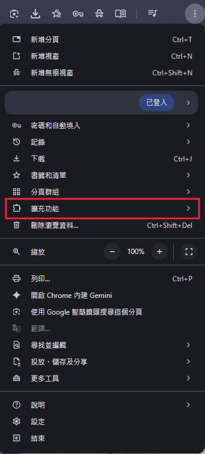
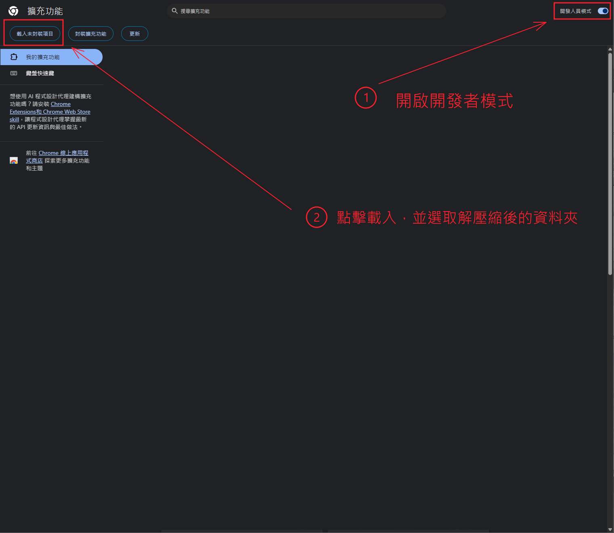
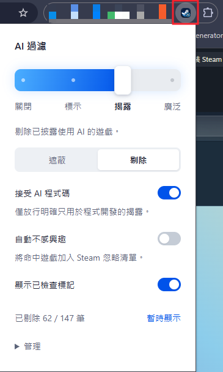

# Steam AI Filter — Steam AI 生成內容過濾器

[繁體中文](README.md) · [English](README.en.md) · [简体中文](README.zh-CN.md)

在 Chrome 瀏覽 Steam 商店時，依商品頁的 AI 使用揭露過濾遊戲。可以標記、遮蔽或隱藏符合所選用途的遊戲卡片。

目前原始碼版本 **v0.10.0（尚未發布）**，可直接載入 [extension/](extension/)；已發布的 **v0.8.0** 安裝包可從 [Releases](https://github.com/RyuuMeow/steam-ai-filter/releases/latest) 下載。以下功能說明對應 v0.10.0，安裝編譯好的插件不需要 Node.js。

[下載插件 RAR](https://github.com/RyuuMeow/steam-ai-filter/releases/download/v0.8.0/steam-ai-filter-v0.8.0.rar) · [MIT 授權](LICENSE)

- **四種模式**：關閉、標記、遮蔽、隱藏，直接由同一個拉桿選擇。
- **自選 AI 用途**：美術、音樂／音效、配音、劇情／文字、翻譯、程式碼、用途不明；預設只開美術。
- **檢查狀態**：已檢查且未命中所選用途顯示綠勾，命中顯示黃勾；遮蔽卡片不顯示勾勾。
- **三種介面語言**：English、繁體中文、简体中文；首次依瀏覽器語言選擇，也可在設定切換。
- **分類設定**：右上齒輪進入檢查與快取、網路、顯示、自動化與例外、語言；設定即時保存。

## 安裝

### 1. 下載並解壓縮

開啟 **[最新 Release](https://github.com/RyuuMeow/steam-ai-filter/releases/latest)**，在 **Assets** 下載 **`steam-ai-filter-v0.8.0.rar`**。

將 RAR **解壓縮至同名資料夾**（例如 WinRAR 的「解壓縮至 steam-ai-filter-v0.8.0\\」）。這個資料夾就是稍後要選取的插件，裡面直接有 `manifest.json`。

```text
steam-ai-filter-v0.8.0/  ← 在 Chrome 選這一層
├── manifest.json
├── background.js
├── popup.html
├── icons/
└── ...
```

選取的資料夾內必須直接看到 `manifest.json`，不要選 RAR 檔。

也可用 **Code → Download ZIP** 下載 repo，完整解壓後選取其中的 **[extension/](extension/)**。

### 2. 開啟 Chrome 擴充功能頁面

在網址列輸入 `chrome://extensions`，或從右上角 **⋮ → 擴充功能 → 管理擴充功能** 進入。



### 3. 開啟開發人員模式並載入插件

開啟右上角的 **開發人員模式**，點選左上角 **載入未封裝項目**，選取第 1 步找到的插件資料夾。



安裝後請保留這個資料夾；Chrome 會持續從此處讀取插件。

### 4. 重新整理 Steam 並開啟設定

重新整理所有已開啟的 Steam 商店分頁。點 Chrome 工具列的拼圖圖示，將 **Steam AI Filter** 釘選，再點插件圖示開啟設定。



上圖為先前版本的工具列操作位置。v0.10.0 首次安裝預設為 **遮蔽**；過濾項目只開啟美術，已檢查圖示開啟，自動不感興趣關閉。

## 使用方式

| 處理模式 | 效果 |
|---|---|
| 關閉 | 還原卡片、移除標記並停止檢查 |
| 標記 | 命中所選用途時，顯示獨立的 AI 與用途標籤 |
| 遮蔽（預設） | 以強烈模糊的毛玻璃遮罩覆蓋命中卡片，保留位置；點擊一次顯示該遊戲 |
| 隱藏 | 收起命中的完整遊戲區塊；不顯示 AI／用途標籤 |

- **過濾項目**：混合用途只要有一項命中就處理。用途不明指「有正式揭露，但無法分類」；尚未檢查、查詢失敗不算。全部取消勾選時，不標記／遮蔽／隱藏，也不新增自動忽略。
- **檢查圖示**：綠勾表示已檢查、未命中所選用途；黃勾表示命中所選用途。遮蔽與隱藏的卡片不顯示勾勾。未命中**不代表沒有使用 AI**。
- **介面語言**：在設定的「語言」切換；只翻譯插件介面，開發者的 Steam 揭露原文保持不變。
- **齒輪設定**：點分類進入下一層，左上返回 icon 退一層，設定即時保存。
- **快取與網路**：預設有揭露保留 7 天、未找到揭露保留 1 天；可改為 1／7／30 天。請求預設間隔 0.7 秒、最多並行 2 個，所有分頁共用。
- **自動不感興趣**：在「自動化與例外」設定，預設關閉。啟用後會修改目前 Steam 帳號的忽略清單，每 30 秒最多處理一款；關閉不會撤回已完成的操作。
- **遮罩操作**：遮罩顯示「AI生成內容」；滑鼠移入或鍵盤聚焦時，淡入「解除遮蔽」「允許此遊戲」「不感興趣」三個按鈕。
- **解除遮蔽**：點按鈕或遮罩空白處，只顯示該遊戲在目前頁面的卡片，不開啟對話框，也不跳轉；角落會出現眼睛圖示按鈕，點擊可恢復遮蔽。切換模式後重設。
- **滑鼠移入顯示**：在「設定 → 顯示設定」開啟，預設關閉；只在滑鼠停留卡片時暫時解除遮蔽，移出立即恢復。手動點擊則持續顯示，直到點擊眼睛或切換模式。
- **允許此遊戲**：加入永久顯示的例外名單，可在設定移除。也可從標記或已隱藏遊戲清單查看揭露並設定例外。
- **不感興趣**：明確點擊後，將這款遊戲加入目前 Steam 帳號的忽略清單；這是單次帳號操作，不會開啟「自動不感興趣」。

完整規則、快取方式與自動忽略的停止／恢復方式，見 [使用與資料處理](docs/usage.md)。

## 更新

1. 將新版插件檔案覆蓋到原本載入的資料夾，保持 `manifest.json` 在同一層。
2. 到 `chrome://extensions`，點 Steam AI Filter 的重新載入按鈕，若使用本 repo 的 `extension/`，確認版本為 **0.10.0**。
3. **重新整理所有 Steam 商店分頁**，讓頁面改用新版程式。

舊「關閉／標示」對應新「關閉／標記」；舊「揭露／廣泛」依原本的遮蔽／剔除選擇，轉為「遮蔽／隱藏」。用途選擇、例外及其他開關保留，新增的用途不明預設關閉。僅有「人工智慧」題材標籤的遊戲不再處理。若出現 `Extension context invalidated`，請重新整理 Steam 分頁。

## 支援範圍與隱私

- 適用於桌面版 Chrome 的 `store.steampowered.com`，包含首頁、搜尋與特價活動等商店路徑；不作用於原生 Steam 客戶端或 Steam 社群。
- 依 Steam 提供的正式 AI 揭露判斷，不分析圖片畫風。未知、查詢失敗或受登入／年齡驗證限制的遊戲會保持可見，首次查詢可能短暫顯示卡片。
- 設定、例外及快取保存在本機；沒有 AI API、共用資料庫或第三方追蹤。需要網路時只向 Steam 商店查詢，並沿用瀏覽器既有 Steam 登入狀態。
- `storage` 用來保存本機資料，`alarms` 用來排程自動忽略；網站存取僅限 Steam 商店。自動忽略涉及帳號操作，詳細行為見 [使用說明](docs/usage.md#自動不感興趣預設關閉)。

Steam 頁面結構變更可能需要更新插件。

## 開發

使用 Node.js 22 或更新版本：

```sh
npm ci
npm run check
npm run package
npm run dev
```

- `src/`：TypeScript 原始碼。
- `public/`：manifest、彈窗、樣式與圖示。
- `extension/`：可直接安裝的編譯產物，由 `npm run package` 更新。
- `tests/`：Node 測試與離線瀏覽器測試頁。
- `docs/`：使用規則、開發指引、設計及驗證紀錄。

推送 `v版本號` 標籤會自動執行檢查並建立 GitHub Release，附件只有插件本體的 RAR。詳見[自動發版](docs/development.md#自動發版)。

[開發與驗證指引](docs/development.md) · [設計與模組分工](docs/design.md) · [驗證紀錄](docs/validation.md)

## 授權

以 [MIT License](LICENSE) 開源。插件安裝包也附有同一份授權文字。原始碼亦可供學習與技術研究參考，此說明不變更 MIT 授權範圍，也不代表獲得 Valve 授權或豁免 Steam 使用條款。

## 免責聲明

- 本專案為獨立開發的非官方工具，與 Valve／Steam 無隸屬關係。
- 過濾結果依開發者揭露、本機關鍵字推斷，可能誤判或漏判。標示不代表對遊戲品質、侵權或開發者行為的認定；未標示也不代表未使用 AI，請以原始揭露自行判斷。
- 「自動不感興趣」會修改目前 Steam 帳號的忽略清單。開啟前請確認過濾設定；關閉後不會撤回已完成的操作，請自行核對帳號變更。
- 使用者應遵守 [Steam 使用條款](https://store.steampowered.com/subscriber_agreement/#4)，並自行評估使用風險。本專案不保證背景查詢或自動帳號操作不會導致請求限制、功能受限、帳號停權或終止。在適用法律允許的範圍內，作者及貢獻者不對因此產生的損失承擔責任。
- 本軟體依 MIT 授權以「現狀」提供，不保證判定準確、資料完整、持續可用或適合特定用途。擔保與責任限制以 [LICENSE](LICENSE) 為準。
